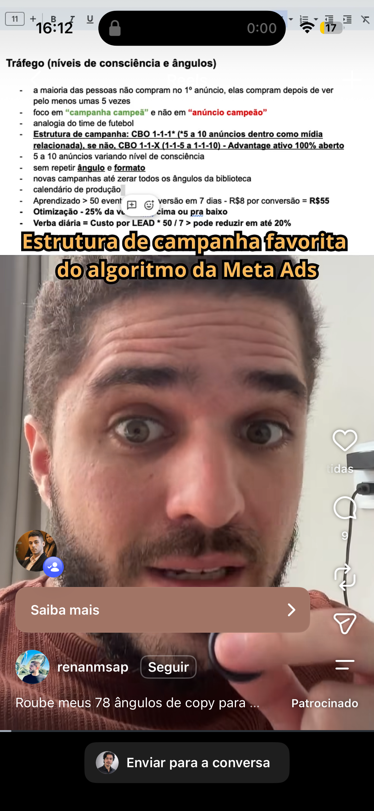
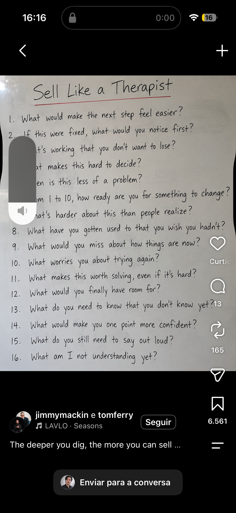

# Prompts do chat — Leo OS (Meta Ads + Vendas)

> As imagens não viram texto quando você copia e cola. Por isso, embaixo de cada imagem está a transcrição do que aparece nela.

---

## Prompt 1 — Biblioteca de ângulos (Meta Ads)

**Texto:**

> Preciso aplicar isso aqui
> Fazendo a estrategia da bibliotecária de angulos !
>
> https://www.instagram.com/reel/Df3Kw_CJTLA/?dmpr=MTBvOHozb3JycXRyNw==

**Imagem anexada:** `IMG_8452.png` (print de um reel patrocinado de @renanmsap)

**Transcrição da imagem:**

**Tráfego (níveis de consciência e ângulos)**

- a maioria das pessoas não compram no 1º anúncio, elas compram depois de ver pelo menos umas 5 vezes
- foco em "campanha campeã" e não em "anúncio campeão"
- analogia do time de futebol
- **Estrutura de campanha: CBO 1-1-1\* (\*5 a 10 anúncios dentro como mídia relacionada), se não, CBO 1-1-X (1-1-5 a 1-1-10) - Advantage ativo 100% aberto**
- 5 a 10 anúncios variando nível de consciência
- sem repetir **ângulo** e **formato**
- novas campanhas até zerar todos os ângulos da biblioteca
- calendário de produção
- Aprendizado > 50 event[os de con]versão em 7 dias - R$8 por conversão = **R$55**
- **Otimização - 25% da ve[rba pra] cima ou pra baixo**
- **Verba diária = Custo por LEAD \* 50 / 7 > pode reduzir em até 20%**

Título no vídeo: *"Estrutura de campanha favorita do algoritmo da Meta Ads"*
Legenda do post: *"Roube meus 78 ângulos de copy para …"*

*(Os trechos entre colchetes estavam cobertos no print e foram completados pelo contexto.)*

---

## Prompt 2 — Sell Like a Therapist (reunião de vendas)

**Texto:** *(só a imagem, sem texto)*

**Imagem anexada:** `IMG_8453.png` (reel de @jimmymackin e @tomferry, legenda: *"The deeper you dig, the more you can sell …"*)

**Transcrição da imagem: "Sell Like a Therapist"**

1. What would make the next step feel easier?
2. If this were fixed, what would you notice first?
3. What's working that you don't want to lose?
4. What makes this hard to decide?
5. When is this less of a problem?
6. From 1 to 10, how ready are you for something to change?
7. What's harder about this than people realize?
8. What have you gotten used to that you wish you hadn't?
9. What would you miss about how things are now?
10. What worries you about trying again?
11. What makes this worth solving, even if it's hard?
12. What would you finally have room for?
13. What do you need to know that you don't know yet?
14. What would make you one point more confident?
15. What do you still need to say out loud?
16. What am I not understanding yet?

---

## Prompt 3 — Este arquivo

> Eu quero que você gere para mim um arquivo Markdown com praticamente todos os prompts que eu dei aqui nesse chat, incluindo as imagens ou links que eu passei. Você consegue fazer isso? Me mandar esse arquivo, esse texto para eu copiar e colar?
